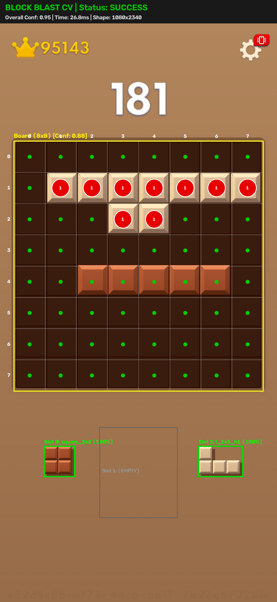

# Block Blast AI Ultimate 🎮🤖

[](https://opensource.org/licenses/MIT)
[](https://www.python.org/)
[](tests/)
[](https://developer.android.com/tools/adb)

> High-performance autonomous AI and real-time computer vision system engineered for the mobile puzzle game **Block Blast**. Operates on real physical Android smartphones via ADB with closed-loop visual feedback, 64-bit bitboard simulation, and 3-ply permutational beam search.

---

## ⚡ Quick Start for Windows (1-Click Launch)

No command-line expertise required! Follow these 3 simple steps:

### 1. Configure Your Phone (One-Time Setup)
1. On your Android phone, go to **Settings** > **About Phone** > tap **Build Number** 7 times to enable Developer Options.
2. Go to **Settings** > **Developer Options** > turn ON **USB Debugging**.
   - *(Xiaomi / MIUI users)*: Also turn ON **USB Debugging (Security settings)** to permit simulated touch input.
3. Connect your phone to your PC with a USB cable, unlock the screen, and tap **Allow** when prompted for USB debugging.

### 2. Double-Click to Install & Launch
1. Double-click **`SETUP.bat`** (first-time only): Automatically sets up your virtual environment, checks ADB, and installs required packages (`NumPy`, `OpenCV`).
2. Double-click **`START.bat`**: Opens the interactive launcher, audits your phone connection, and displays the launch menu.

### 3. What Successful Startup Looks Like
When `START.bat` runs, you will see your detected phone:
```text
==========================================================================
  BLOCK BLAST AI ULTIMATE - AUTONOMOUS BOT LAUNCHER
==========================================================================
[OK] Using virtual environment Python: .venv\Scripts\python.exe
[OK] ADB Bridge detected: C:\platform-tools\adb.exe
[OK] Connected Device: 1234567890ABCDEF [READY]
```
Press **`1`** (or Enter) to launch the autonomous game loop:
```text
==========================================================================
  BLOCK BLAST AI ULTIMATE — FULL AUTONOMOUS GAME LOOP
==========================================================================
  Device: 1234567890ABCDEF  [LIVE]     State: [IDLE       ] Uptime: 0s
  Turns: 0/0 (100.0% OK) | Score Delta: +0 | Lines: 0 | Refills: 0
  Turn Latency: (Awaiting first turn execution...)
--------------------------------------------------------------------------
  CONTROLS: [S] Start / Resume   [P] Pause   [Space] Single Step   [Q] Stop
==========================================================================
```
- Open **Block Blast** on your phone to a fresh 8x8 game board.
- Press **`S`** in your console window to begin autonomous play!
- Press **`P`** at any time to pause and immediately release touch pointers.
- Press **`Q`** to stop and exit safely.

---

## 🌟 Key Features

- **64-Bit Bitboard Engine**: Pure mathematical representation using unsigned 64-bit integers (`uint64`). Placement collisions and line clears execute in nanoseconds using bitwise operations (`AND`, `OR`, `XOR`).
- **3-Ply Permutational Beam Search**: Evaluates up to $3! = 6$ piece orderings and thousands of board states per turn with multi-metric heuristics (holes penalty, bumpiness, aggregate height, combo preservation).
- **Adaptive Computer Vision Pipeline**: Automatically detects 8x8 grid boundaries, segments colorful gem tiles in HSV color space, handles dynamic game brightness, and identifies pieces using the **Canonical 41 Polyomino Catalog**.
- **Human-like Bezier Curve Touch Actuation**: Injects smooth cubic Bezier swipe curves via ADB with realistic velocity profiling to ensure reliable touch registration.
- **Single-Frame Fast-Path Verification**: Verifies completed moves in a single capture frame (~15ms vision latency) when perception confidence is 100%, falling back to two-frame stability checks during animations.
- **Zero-Capture Frame Reuse**: Reuses verified end-of-turn frames as input for the subsequent turn, eliminating redundant screencaps and cutting turn latency.
- **Built-in Safety & Emergency Stops**: One-key pause (`P`), instant touch release, dry-run mode, and automated diagnostic dumps upon uncertain perception.

---

## 📸 Vision & Perception Demo

Below is a real perception frame processed by `BlockBlastRecognizer`, showcasing 8x8 grid bounding box detection, individual cell occupancy classification, and tray piece identification:

<p align="center">
  
</p>

---

## 🏗️ Architecture Overview

The system is organized into modular layers with strict separation of concerns:

```text
block_blast_ai/
├── action_engine/        # Hardware interaction: ADB capture, Bezier drag, move verifier, controller
│   ├── adb_capture.py           # Screencap and raw socket streaming
│   ├── action_verifier.py       # Single-frame fast-path & two-frame settle verification
│   ├── autonomous_controller.py # Master state machine and live dashboard
│   ├── bezier.py                # Cubic Bezier trajectory math
│   └── drag_controller.py       # Touch event injection via ADB
├── ai_engine/            # Decision intelligence: search algorithms & heuristics
│   ├── beam_search.py           # 3-ply permutational Beam Search
│   ├── evaluator.py             # Multi-factor board evaluation
│   └── pruning.py               # Candidate move pruning & deduplication
├── computer_vision/      # Screen perception: detection & classification
│   ├── board_detector.py        # 8x8 grid boundary localization
│   ├── cell_classifier.py       # HSV color space cell state analysis
│   ├── piece_classifier.py      # Canonical 41 polyomino matching
│   └── recognizer.py            # Master perception aggregator
├── game_engine/          # Domain model: 64-bit bitboards & game rules
│   ├── bitboard.py              # 64-bit bitboard math and line clearing
│   ├── board.py                 # Coordinate-to-bit mappings
│   ├── pieces.py                # Canonical 41 polyomino catalog
│   └── simulator.py             # Pure functional game simulation
├── tests/                # Comprehensive unit test suite (246 tests)
└── docs/                 # Documentation, installation guides, and architecture specs
```

For detailed mathematical formulations and sequence diagrams, refer to [Architecture Documentation](docs/architecture.md).

---

## 🚀 Getting Started

### 1. Prerequisites
- **Python**: 3.9 or higher.
- **ADB (Android Debug Bridge)**: Installed and added to system `PATH`.
- **Android Phone**: Any Android device with USB Debugging enabled.

### 2. Installation
```bash
# Clone the repository
git clone https://github.com/<your-username>/block-blast-ai.git
cd block-blast-ai

# Create and activate virtual environment
python -m venv .venv

# Windows (PowerShell):
.venv\Scripts\Activate.ps1
# Linux / macOS:
source .venv/bin/activate

# Install dependencies
pip install -r requirements.txt
pip install -e .
```

For complete step-by-step ADB instructions, see the [Installation Guide](docs/installation.md).

---

## 🎮 Running the Application

### 1. Dry-Run Mode (Read-Only Safety Check)
Before allowing the AI to physically touch your phone, test the screen capture and vision pipeline in read-only mode:

```bash
python run_autonomous_game.py --dry-run
```
In dry-run mode, the AI captures the screen, recognizes the board, plans the optimal move, and prints telemetry—without injecting any physical touch events.

### 2. Live Autonomous Game Mode
Once dry-run confirms accurate perception, launch full autonomous play:

```bash
python run_autonomous_game.py
```

Optional CLI flags:
- `--device <serial>`: Specify target ADB device (auto-detected by default).
- `--max-turns <N>`: Stop after $N$ turns.
- `--adb-path <path>`: Custom path to `adb` executable.
- `--debug`: Enable verbose diagnostic logging.

### 3. Interactive CLI Simulator
Play or benchmark the AI in a terminal-based simulator with zero Android hardware dependencies:

```bash
python cli_demo.py
```

---

## 🕹️ Interactive Real-Time Controls

While `run_autonomous_game.py` is active, you can interact with the live game loop at any time:

| Key | Action | Description |
| :---: | :---: | :--- |
| **`S`** | **Start / Resume** | Begins autonomous play or resumes from paused state. |
| **`P`** | **Pause** | Instantly halts the AI loop and releases any active touch pointers. |
| **`Space`** | **Single Step** | Executes exactly one move and returns to paused state. |
| **`Q`** | **Stop & Exit** | Safely cleans up resources, releases touch pointers, and exits. |

---

## 🛡️ Safety & Reliability

- **Touch Safety**: The controller continuously tracks touch state (`_touch_pointer_down`). Any pause, abort, or exception immediately triggers `release_touch()`.
- **Perception Gating**: If any cell is classified as `UNCERTAIN` or confidence falls below safe thresholds (0.70 per cell), the controller pauses execution and dumps full diagnostic screenshots to `debug/perception_failures/`.
- **Post-Action Verification**: Every move is verified against the mathematically expected bitboard. If pieces are rejected or misplaced, the AI safely recovers.

---

## 🧪 Testing & Verification

The project includes 246 unit, property, and regression tests covering all game rules, bitboard operations, vision classifiers, beam search permutations, and actuation controllers.

```bash
# Run the full test suite
python -m unittest discover tests
```

Expected output:
```text
Ran 246 tests in ~45s
OK
```

---

## 🗺️ Roadmap & Limitations

- **Current Limitations**:
  - Requires phone in portrait orientation.
  - ADB screencap speed depends on device USB speed (USB 3.0 recommended).
- **Upcoming Roadmap**:
  - [ ] Scrcpy video stream decoder integration for <10ms capture latency.
  - [ ] Deep reinforcement learning policy network integration for 5-ply lookahead.
  - [ ] Cross-platform desktop emulator support (BlueStacks, LDPlayer).

---

## 📄 License & Contributing

- Distributed under the **MIT License**. See [`LICENSE`](LICENSE) for details.
- Contributions and PRs are welcome! Please read [`CONTRIBUTING.md`](CONTRIBUTING.md) before submitting code.
- Tiếng Việt: Xem [`README_VI.md`](README_VI.md) để đọc hướng dẫn bằng tiếng Việt.
