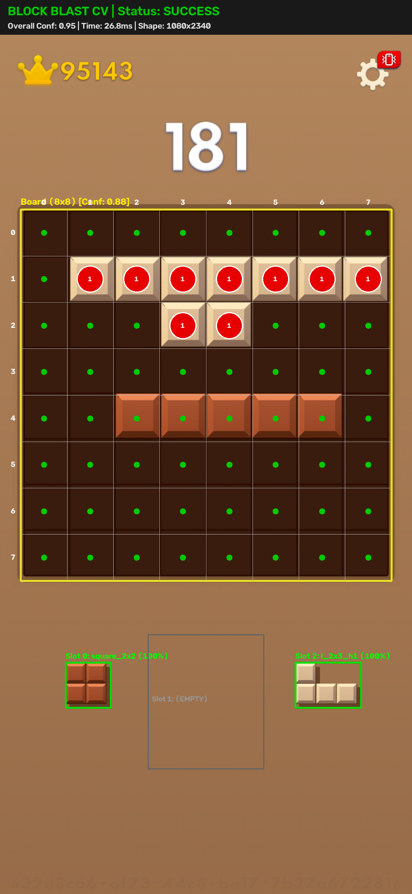

# Block Blast AI Ultimate 🎮🤖 (Tiếng Việt)

[](https://opensource.org/licenses/MIT)
[](https://www.python.org/)
[](tests/)
[](https://developer.android.com/tools/adb)

> Hệ thống trí tuệ nhân tạo (AI) và thị giác máy tính (Computer Vision) thời gian thực hiệu năng cao dành cho trò chơi giải đố **Block Blast**. Hoạt động trực tiếp trên điện thoại Android vật lý qua ADB với vòng lặp phản hồi thị giác khép kín (closed-loop), mô phỏng Bitboard 64-bit và thuật toán tìm kiếm chùm (Beam Search) hoán vị 3 tầng (3-ply).

---

## ⚡ Khởi Chạy Nhanh Cho Windows (Chạy Bằng 1 Cú Nhấp Chuột)

Dành cho người mới bắt đầu, không yêu cầu gõ lệnh phức tạp:

### 1. Cấu Hình Điện Thoại (Chỉ làm 1 lần đầu)
1. Mở **Cài đặt (Settings)** trên điện thoại Android > **Thông tin điện thoại (About Phone)** > chạm liên tục 7 lần vào **Số hiệu bản dựng (Build Number)** để mở Tùy chọn nhà phát triển.
2. Vào **Cài đặt** > **Cài đặt cho người phát triển (Developer Options)** > Bật **Gỡ lỗi USB (USB Debugging)**.
   - *(Dành cho máy Xiaomi / MIUI / HyperOS)*: Bật thêm mục **Gỡ lỗi USB (Cài đặt bảo mật / Security settings)** để cho phép máy tính gửi thao tác vuốt cảm ứng.
3. Cắm cáp USB nối điện thoại với máy tính, mở khóa màn hình điện thoại, tích vào ô **Luôn cho phép từ máy tính này** và chọn **Cho phép (Allow)**.

### 2. Cài Đặt & Khởi Chạy Tự Động
1. Nhấp đúp chuột vào file **`SETUP.bat`** (chỉ cần chạy lần đầu): Tự động tạo môi trường ảo `.venv`, kiểm tra ADB và cài đặt thư viện (`NumPy`, `OpenCV`).
2. Nhấp đúp chuột vào file **`START.bat`**: Mở bảng điều khiển tương tác, tự động kiểm tra kết nối điện thoại và hiển thị menu chọn chế độ.

### 3. Giao Diện Khi Khởi Chạy Thành Công
Khi chạy `START.bat`, hệ thống sẽ tự động phát hiện thiết bị:
```text
==========================================================================
  BLOCK BLAST AI ULTIMATE - AUTONOMOUS BOT LAUNCHER
==========================================================================
[OK] Using virtual environment Python: .venv\Scripts\python.exe
[OK] ADB Bridge detected: C:\platform-tools\adb.exe
[OK] Connected Device: 1234567890ABCDEF [READY]
```
Nhấn phím **`1`** (hoặc Enter) để bắt đầu vòng lặp game tự động:
```text
==========================================================================
  BLOCK BLAST AI ULTIMATE — FULL AUTONOMOUS GAME LOOP
==========================================================================
  Device: 1234567890ABCDEF  [LIVE]     State: [IDLE       ] Uptime: 0s
  Turns: 0/0 (100.0% OK) | Score Delta: +0 | Lines: 0 | Refills: 0
  Turn Latency: (Awaiting first turn execution...)
--------------------------------------------------------------------------
  CONTROLS: [S] Start / Resume   [P] Pause   [Space] Single Step   [Q] Stop
==========================================================================
```
- Mở game **Block Blast** trên điện thoại vào bàn cờ mới 8x8.
- Nhấn phím **`S`** trong cửa sổ console để AI bắt đầu chơi tự động!
- Nhấn phím **`P`** bất kỳ lúc nào để tạm dừng và lập tức giải phóng cảm ứng.
- Nhấn phím **`Q`** để dừng và thoát an toàn.

---

## 🌟 Tính Năng Nổi Bật

- **Động Cơ Bitboard 64-Bit Siêu Tốc**: Bàn cờ 8x8 được biểu diễn bằng số nguyên không dấu 64-bit (`uint64`). Kiểm tra va chạm và xóa hàng/cột hoàn thành trong vài nano giây bằng toán tử bit (`AND`, `OR`, `XOR`).
- **Beam Search Hoán Vị 3 Tầng**: Đánh giá toàn bộ $3! = 6$ thứ tự kéo thả quân trong khay cùng hàng nghìn trạng thái bàn cờ với hàm heuristic đa mục tiêu (phạt lỗ hổng, giảm độ gồ ghề `bumpiness`, hạ chiều cao bàn cờ và tối đa chuỗi combo).
- **Thị Giác Máy Tính Tự Thích Ứng**: Tự động phát hiện tọa độ lưới 8x8, phân loại ô màu trong không gian màu HSV, thích ứng với độ sáng nền thay đổi, và nhận diện quân cờ dựa trên **Danh mục 41 khối chuẩn (Canonical 41 Polyomino Catalog)**.
- **Vuốt Cảm Ứng Đường Cong Bezier Giống Người**: Tạo quỹ đạo vuốt mượt mà theo đường cong Bezier bậc 3 qua ADB với gia tốc mượt mà, hạn chế tối đa việc tuột tay hoặc lỗi cảm ứng.
- **Xác Minh Nhanh 1 Khung Hình (Single-Frame Fast-Path)**: Xác minh nước đi chỉ với 1 ảnh chụp (~15ms thời gian xử lý) khi độ tin cậy đạt 100%, tự động chuyển sang cơ chế 2 khung hình khi bàn cờ còn hiệu ứng nổ khối.
- **Tái Sử Dụng Khung Hình (Zero-Capture Frame Reuse)**: Khung hình đã xác minh ở cuối lượt $N$ được tái sử dụng ngay làm dữ liệu đầu vào cho lượt $N+1$, loại bỏ thao tác chụp màn hình trùng lặp qua ADB và giảm độ trễ nước đi.
- **Cơ Chế An Toàn Chủ Động**: Phím tạm dừng tức thì (`P`), tự động nhả cảm ứng (`release_touch`), chế độ chạy thử an toàn (`--dry-run`), và tự động lưu ảnh chụp chẩn đoán khi gặp ô không chắc chắn (`UNCERTAIN`).

---

## 📸 Minh Họa Thị Giác & Nhận Diện

Hình ảnh thực tế được xử lý bởi `BlockBlastRecognizer`, minh họa việc định vị khung bàn cờ 8x8, phân loại từng ô và nhận diện 3 khối cờ trong khay:

<p align="center">
  
</p>

---

## 🏗️ Kiến Trúc Hệ Thống

Dự án được phân chia thành các tầng module độc lập, chuẩn hóa:

```text
block_blast_ai/
├── action_engine/        # Tương tác phần cứng: chụp ADB, kéo Bezier, xác minh nước đi, FSM
│   ├── adb_capture.py           # Chụp màn hình qua pipe & raw socket
│   ├── action_verifier.py       # Xác minh Fast-Path 1 khung hình & Two-Frame dự phòng
│   ├── autonomous_controller.py # Máy trạng thái hữu hạn FSM và dashboard giao diện console
│   ├── bezier.py                # Toán học đường cong Bezier bậc 3
│   └── drag_controller.py       # Điều khiển cử chỉ cảm ứng qua ADB
├── ai_engine/            # Trí tuệ ra quyết định: thuật toán tìm kiếm & đánh giá heuristic
│   ├── beam_search.py           # Beam Search hoán vị 3 tầng
│   ├── evaluator.py             # Hàm đánh giá đa yếu tố bàn cờ
│   └── pruning.py               # Cắt tỉa nhánh tìm kiếm và loại bỏ trạng thái trùng
├── computer_vision/      # Thị giác máy tính: nhận diện bàn cờ và phân loại khối
│   ├── board_detector.py        # Định vị khung lưới 8x8
│   ├── cell_classifier.py       # Phân tích trạng thái ô trong không gian HSV
│   ├── piece_classifier.py      # So khớp 41 khối chuẩn trong khay
│   └── recognizer.py            # Tổng hợp nhận diện khung hình hoàn chỉnh
├── game_engine/          # Mô hình nghiệp vụ: Bitboard 64-bit và quy luật game
│   ├── bitboard.py              # Xử lý bitboard và logic xóa hàng/cột
│   ├── board.py                 # Ánh xạ tọa độ (hàng, cột) sang bit
│   ├── pieces.py                # Danh mục 41 khối cờ chuẩn
│   └── simulator.py             # Mô phỏng đặt quân thuần túy
├── tests/                # Bộ kiểm thử tự động toàn diện (246 bài test)
└── docs/                 # Tài liệu hướng dẫn, cài đặt và kiến trúc
```

Xem chi tiết tại [Tài Liệu Kiến Trúc (Architecture)](docs/architecture.md).

---

## 🚀 Hướng Dẫn Cài Đặt

### 1. Yêu Cầu Tiên Quyết
- **Python**: Phiên bản 3.9 trở lên (đã kiểm thử tốt trên 3.9 đến 3.13).
- **ADB (Android Debug Bridge)**: Đã cài đặt và có trong biến môi trường `PATH`.
- **Điện thoại Android**: Đã bật **Tùy chọn cho nhà phát triển** và **Gỡ lỗi USB (USB Debugging)**.

### 2. Cài Đặt Môi Trường
```bash
# Sao chép repository
git clone https://github.com/<your-username>/block-blast-ai.git
cd block-blast-ai

# Tạo và kích hoạt môi trường ảo Python
python -m venv .venv

# Windows (PowerShell):
.venv\Scripts\Activate.ps1
# Linux / macOS:
source .venv/bin/activate

# Cài đặt các thư viện phụ thuộc
pip install -r requirements.txt
pip install -e .
```

Chi tiết từng bước cấu hình ADB trên điện thoại, xem tại [Hướng Dẫn Cài Đặt (Installation Guide)](docs/installation.md).

---

## 🎮 Cách Chạy Chương Trình

### 1. Chế Độ Chạy Thử An Toàn (Dry-Run Mode)
Trước khi cho phép AI thao tác trực tiếp trên màn hình cảm ứng, hãy chạy thử ở chế độ chỉ đọc:

```bash
python run_autonomous_game.py --dry-run
```
Ở chế độ này, AI sẽ chụp màn hình, nhận diện bàn cờ, tính toán nước đi tối ưu và hiển thị thông số trên console mà **không phát bất kỳ thao tác chạm vật lý nào**.

### 2. Chế Độ Tự Động Hoàn Toàn (Live Autonomous Mode)
Sau khi xác nhận thị giác nhận diện chính xác ở chế độ chạy thử:

```bash
python run_autonomous_game.py
```

Các tham số dòng lệnh tùy chọn:
- `--device <serial>`: Chỉ định serial thiết bị ADB (mặc định tự động nhận diện thiết bị đang kết nối).
- `--max-turns <N>`: Dừng sau $N$ lượt đi.
- `--adb-path <path>`: Đường dẫn tùy chỉnh tới file thực thi `adb`.
- `--debug`: Bật log chẩn đoán chi tiết.

### 3. Mô Phỏng Dòng Lệnh Độc Lập (CLI Demo)
Trải nghiệm hoặc đánh giá hiệu năng thuật toán AI mà không cần kết nối điện thoại:

```bash
python cli_demo.py
```

---

## 🕹️ Phím Điều Khiển Trực Tiếp

Khi chương trình `run_autonomous_game.py` đang chạy, bạn có thể điều khiển trực tiếp từ bàn phím console:

| Phím | Thao Tác | Mô Tả |
| :---: | :---: | :--- |
| **`S`** | **Start / Resume** | Bắt đầu vòng lặp tự động hoặc tiếp tục sau khi tạm dừng. |
| **`P`** | **Pause** | Dừng AI ngay lập tức và giải phóng mọi điểm chạm cảm ứng đang giữ. |
| **`Space`** | **Single Step** | Thực hiện đúng 1 nước đi rồi quay về trạng thái tạm dừng. |
| **`Q`** | **Stop & Exit** | Dọn dẹp tài nguyên, nhả cảm ứng và thoát an toàn. |

---

## 🛡️ Cơ Chế An Toàn & Khả Năng Chống Lỗi

- **Giải phóng cảm ứng khẩn cấp**: Bộ điều khiển liên tục theo dõi trạng thái chạm (`_touch_pointer_down`). Khi tạm dừng hoặc có lỗi bất ngờ, hệ thống gọi ngay `release_touch()`.
- **Cổng an toàn nhận diện**: Nếu có bất kỳ ô nào bị đánh dấu `UNCERTAIN` hoặc độ tin cậy dưới ngưỡng an toàn (0.70/ô), AI lập tức tạm dừng và lưu toàn bộ ảnh chẩn đoán vào `debug/perception_failures/`.
- **Xác minh hậu động tác**: Mọi nước đi đều được so sánh với bitboard dự kiến theo toán học. Nếu quân bị game từ chối hoặc trượt tay, hệ thống sẽ phát hiện và xử lý an toàn.

---

## 🧪 Kiểm Thử Tự Động

Dự án bao gồm 246 bài kiểm thử bao phủ toàn bộ logic bitboard, thị giác máy tính, tìm kiếm Beam Search và cơ chế điều khiển:

```bash
# Chạy toàn bộ test suite
python -m unittest discover tests
```

Kết quả kỳ vọng:
```text
Ran 246 tests in ~45s
OK
```

---

## 🗺️ Hạn Chế Hiện Tại & Lộ Trình

- **Hạn chế**:
  - Điện thoại cần đặt ở chiều dọc (portrait).
  - Tốc độ chụp ADB phụ thuộc vào cổng kết nối USB (khuyến nghị USB 3.0).
- **Lộ trình phát triển**:
  - [ ] Tích hợp bộ giải mã luồng video Scrcpy để đạt độ trễ chụp <10ms.
  - [ ] Tích hợp mạng học tăng cường sâu (Deep Reinforcement Learning) cho khả năng nhìn trước 5 tầng (5-ply).
  - [ ] Hỗ trợ các trình giả lập Android trên máy tính (BlueStacks, LDPlayer).

---

## 📄 Bản Quyền & Đóng Góp

- Phát hành theo giấy phép mã nguồn mở **MIT License**. Xem chi tiết tại [`LICENSE`](LICENSE).
- Mọi đóng góp và Pull Request đều được hoan nghênh! Vui lòng đọc [`CONTRIBUTING.md`](CONTRIBUTING.md) trước khi gửi PR.
- English version: See [`README.md`](README.md).
