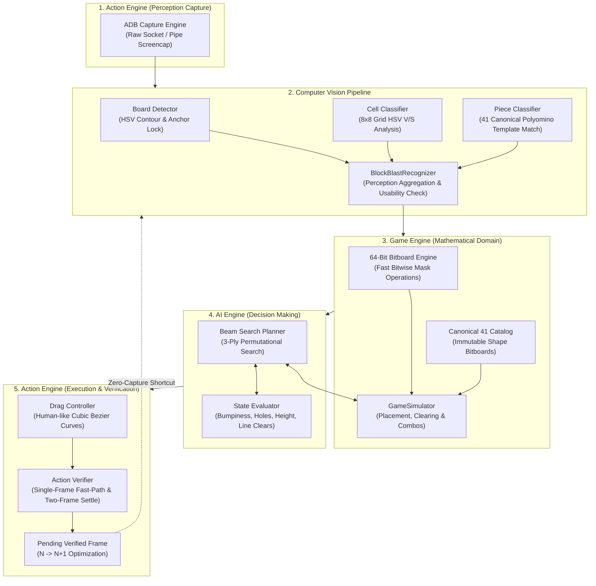
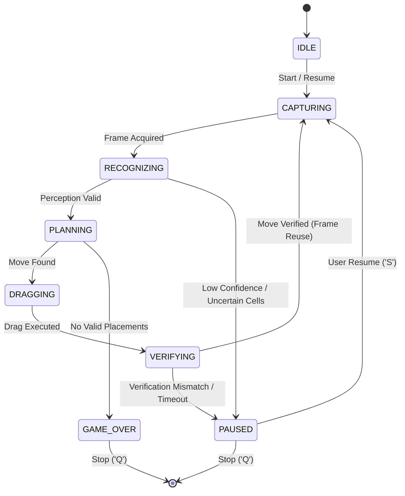

# Block Blast AI — System Architecture & Design

Block Blast AI is an autonomous, real-time artificial intelligence and computer vision bot engineered for the mobile puzzle game **Block Blast**.

This document outlines the system architecture, mathematical formulations, algorithmic search design, and closed-loop control pipeline.

---

## 1. High-Level Architecture Overview

The system is organized into four core decoupled layers:



---

## 2. Game Engine: 64-Bit Bitboard Representation

Instead of representing the 8x8 grid as a 2D array of integers or booleans, the board state is stored as a single **64-bit unsigned integer (`uint64`)**.

### Bit Layout
Each cell $(r, c)$ corresponds to bit index $k = r \times 8 + c$, where $(0, 0)$ is the top-left cell:

$$\text{bit\_index}(r, c) = r \cdot 8 + c \quad (0 \le r, c < 8)$$

$$\text{bitmask}(r, c) = 1 \ll (r \cdot 8 + c)$$

```text
Bit 0  (r=0, c=0) . . . . . . . . Bit 7  (r=0, c=7)  <- Row 0
Bit 8  (r=1, c=0) . . . . . . . . Bit 15 (r=1, c=7)  <- Row 1
...
Bit 56 (r=7, c=0) . . . . . . . . Bit 63 (r=7, c=7)  <- Row 7
```

### Ultra-Fast Collision & Placement
Placing a piece at row $r$ and col $c$ with piece bitmask $M$:
- **Collision Detection**: If `(board & M) != 0`, placement is invalid (instant bitwise AND).
- **Placement**: `new_board = board | M` (instant bitwise OR).

### Bitwise Line Clearing
Lines are detected and cleared using precomputed masks:
- Row $r$ mask: $M_{\text{row}}(r) = 0\text{xFF} \ll (r \cdot 8)$
- Col $c$ mask: $M_{\text{col}}(c) = 0x0101010101010101 \ll c$

When a row is full (`(board & M_row) == M_row`), or a column is full (`(board & M_col) == M_col`), the cleared board is computed by bitwise AND with inverted clearing masks:

$$\text{cleared\_board} = \text{placed\_board} \ \& \ (\sim \text{clearing\_mask})$$

This executes in less than 50 nanoseconds per simulation on modern processors.

---

## 3. Computer Vision: Real-Time Perception Pipeline

The vision pipeline converts raw RGB Android screencaps into structured `GameState` objects:

### 1. Board Localization (`BoardDetector`)
- Automatically detects the 8x8 playfield boundaries.
- Rejects false positives by validating square aspect ratios ($0.95 \le \text{ratio} \le 1.05$) and expected scale anchors (~548px vertical anchor on 1080x2340 screens).

### 2. Multi-Metric Cell Classification (`CellClassifier`)
- Samples an inner region of interest (ROI) per cell (avoiding borders and grid dividers).
- Analyzes HSV Color Space:
  - **Grayscale Value ($V$) & Saturation ($S$) Ratio**: Accurately discriminates empty dark tiles from vibrant gem blocks.
  - **Dynamic Brightness Adaptation**: Accommodates varying game themes, score popups, and elevated background illumination.
  - Assigns per-cell confidence scores; any cell with sub-threshold confidence or boundary ambiguity is flagged as `UNCERTAIN` to prevent rogue gameplay moves.

### 3. Tray Piece Identification (`PieceClassifier`)
- Segments the 3 bottom piece slots in the game tray.
- Matches connected components against the **Canonical 41 Polyomino Catalog** (dots, lines 1x2 to 1x5, squares 2x2 and 3x3, L-shapes, T-shapes, Z-shapes, diagonals, and crosses).
- Calculates normalized IoU and cross-correlation matching scores.

---

## 4. AI Engine: Permutational Beam Search

At each turn, the player is presented with up to 3 pieces in the tray. These pieces can be played in any order (up to $3! = 6$ permutations).

### Search Algorithm (`BeamSearchPlanner`)
1. **Permutation Exploration**: Generates all legal orderings of available tray pieces:
   - For 3 pieces: $[(0, 1, 2), (0, 2, 1), (1, 0, 2), (1, 2, 0), (2, 0, 1), (2, 1, 0)]$.
2. **Move Generation**: At ply $d$, enumerates all legal $(r, c)$ placements for piece $P_d$ on current bitboard $B$.
3. **Pruning & Beam Filtering**:
   - Scores candidate transitions using a multi-factor heuristic evaluation function.
   - Retains only the top $K$ promising candidates (beam width $K=20$) to advance to ply $d+1$.
4. **Optimal Path Selection**: The sequence maximizing cumulative utility over 3 plies is selected for physical actuation.

### Heuristic Evaluation Metrics (`evaluator.py`)
The evaluation function optimizes for survival, combo preservation, and board cleanliness:

$$U(s) = w_1 \cdot \text{LinesCleared} - w_2 \cdot \text{AggregateHeight} - w_3 \cdot \text{Holes} - w_4 \cdot \text{Bumpiness} + w_5 \cdot \text{TrayClearingBonus}$$

- **Holes Penalty**: Counts enclosed empty cells that have occupied neighbors blocking placement.
- **Bumpiness Penalty**: Sum of adjacent column height differentials $\sum_{c=0}^6 |h_c - h_{c+1}|$.
- **Line Clearing & Combo Preservation**: Heavily incentivizes multi-line clears and maintains combo streaks.

---

## 5. Action Engine: Closed-Loop Physical Actuation

The action engine bridges digital decisions to physical hardware through ADB.

### Cubic Bezier Gesture Generation (`bezier.py`)
Raw straight-line drags are easily flagged by mobile OS anti-cheat mechanisms and can drop touch events. The system generates smooth, human-like cubic Bezier trajectories:

$$B(t) = (1-t)^3 P_0 + 3(1-t)^2 t P_1 + 3(1-t) t^2 P_2 + t^3 P_3 \quad (0 \le t \le 1)$$

- **$P_0$**: Tray piece center.
- **$P_1, P_2$**: Control points calculated with realistic arc displacement.
- **$P_3$**: Target grid coordinates adjusted for piece grab offset (accounting for finger obscuration).
- Velocity is profiled with smooth acceleration and deceleration phases.

### Post-Action Verification & Fast-Path (`action_verifier.py`)
After a piece is dropped:
1. **Single-Frame Fast-Path**: If the immediate capture has 100% stable confidence, all 64 cells match expected bitboard $\text{expected\_bb}$, and the tray slot is confirmed empty, the turn is verified immediately (~15ms vision latency).
2. **Two-Frame Fallback**: If particle animations or score popups are detected, a two-frame stability check verifies frame consistency ($A = B$) before confirming placement.
3. **Pending Frame Reuse**: The verified frame from Turn $N$ is directly forwarded to Turn $N+1$ perception, eliminating redundant ADB screencaps and saving ~1500ms per turn.

---

## 6. Autonomous Controller State Machine

The master controller (`AutonomousGameController`) operates as a deterministic finite-state machine:



### Safety & Emergency Mechanisms
- **Immediate Touch Release**: Pausing or stopping the bot immediately releases any active touch pointers to prevent the phone from staying in a dragged state.
- **Automatic Diagnostics**: If perception flags an unknown piece or uncertain board, full-screen diagnostic screenshots and JSON bounding boxes are automatically saved to `debug/perception_failures/`.
